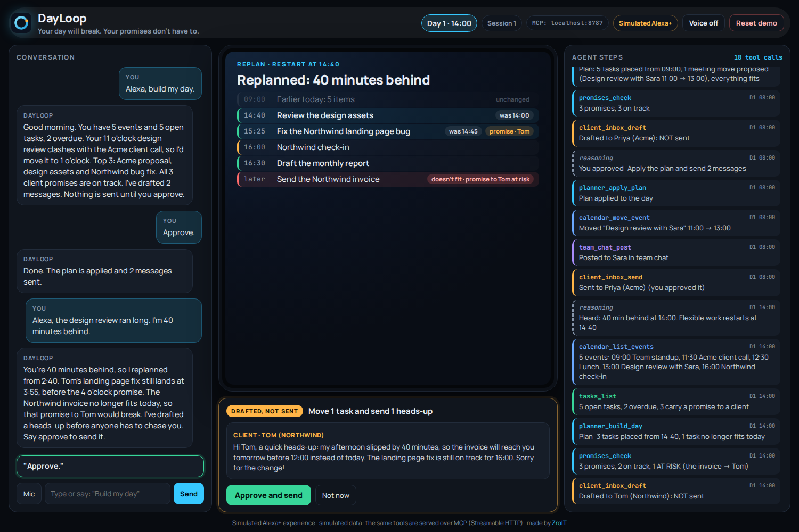
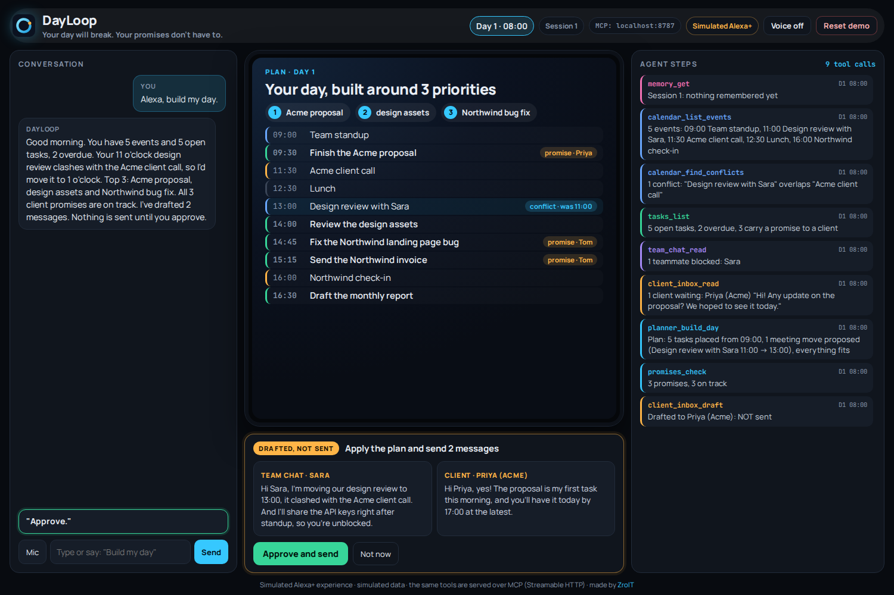
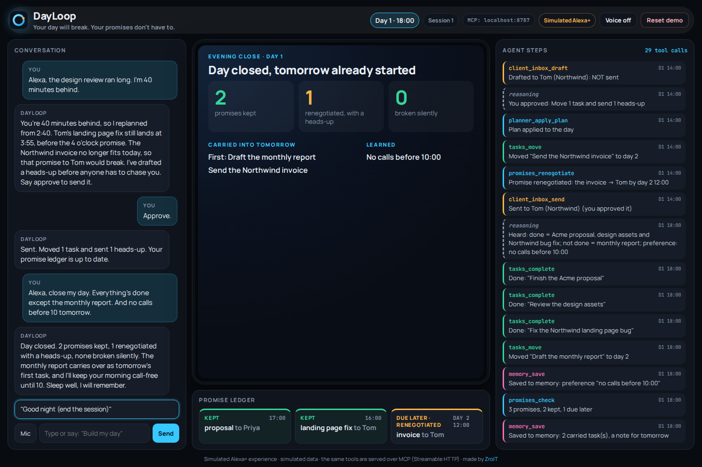
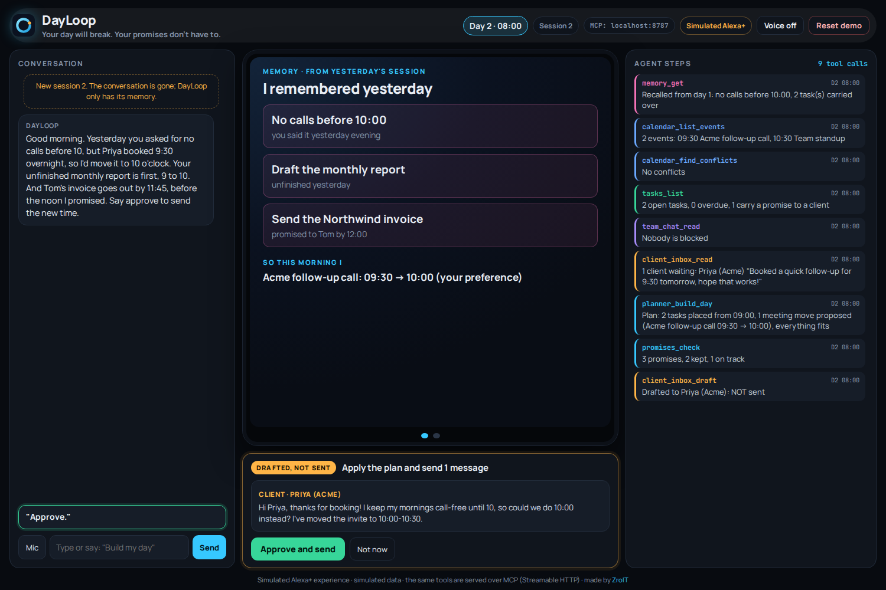
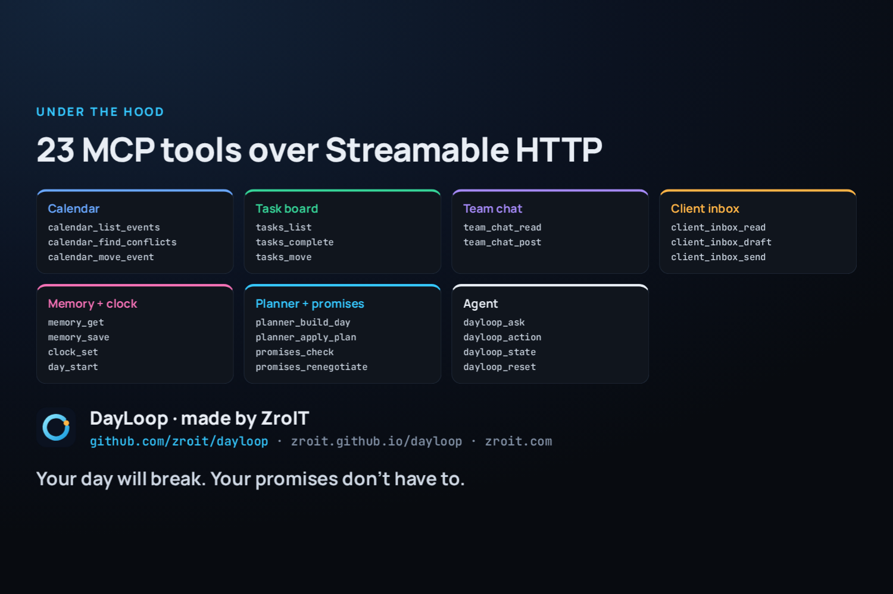

<p align="center"></p>

<h1 align="center">DayLoop</h1>

<p align="center"><b>Your day will break. Your promises don't have to.</b></p>

<p align="center">A simulated Alexa+ agent that runs your workday, keeps your promises to clients, and remembers tomorrow.</p>

<p align="center"><a href="https://zroit.github.io/dayloop/"><b>Live demo</b></a> · <a href="#run-it">Run it</a> · <a href="#the-mcp-server">MCP server</a> · <a href="#how-it-is-built">How it is built</a></p>



> **Simulated experience.** Built for the Alexa+ track of the Amazon Developer Hackathon, simulated experience path. There is no real Alexa skill, calendar or inbox, and all data is invented. The plans, promise checks, drafts and memory are computed from that data by the code in this repo, and the same tools are served by a real MCP server over Streamable HTTP.

## The problem

A calendar manages time. What a freelancer actually loses clients over is a broken promise: "you'll have the proposal today", "the invoice goes out tonight", "the bug is fixed before our 4 o'clock". When a meeting runs long, those promises break quietly, and the client is the first to notice.

DayLoop keeps a ledger of those promises. When the day slips, it works out which promise is about to break and drafts an honest heads-up *before the client has to chase you*. Nothing leaves DayLoop without your approval.

## One loop, two days

<table>
<tr>
<td width="50%" valign="top">
<br>
<b>08:00 · "Alexa, build my day."</b><br>
DayLoop reads the calendar, task board, team chat and client inbox itself, moves an internal meeting out of a clash with a client call, packs tasks by priority and checks every promise against the plan. A note to a blocked teammate and a reply to a waiting client are drafted, not sent.
</td>
<td width="50%" valign="top">
<br>
<b>14:00 · "I'm 40 minutes behind."</b><br>
It replans from 14:40. Tom's bug fix still lands before his 16:00 call, but his invoice no longer fits today. So it drafts the heads-up, moves the invoice to tomorrow morning, and waits for your yes.
</td>
</tr>
<tr>
<td width="50%" valign="top">
<br>
<b>18:00 · "Close my day. Everything's done except the monthly report. And no calls before 10 tomorrow."</b><br>
The day is scored: 2 promises kept, 1 renegotiated with a heads-up, 0 broken silently. Unfinished work and the new rule go into memory.
</td>
<td width="50%" valign="top">
<br>
<b>Day 2, 08:00 · a new session</b><br>
No conversation, only memory, and DayLoop speaks first. A client booked 09:30 overnight, which breaks yesterday's rule, so it proposes 10:00 and drafts the note. The unfinished report goes first, and the invoice lands before the noon it promised.
</td>
</tr>
</table>

Every step is a tool call, listed live in the **Agent steps** panel on the right.

The numbers are not scripted. Say you are 20 or 90 minutes behind, or ask for "no calls before 11", and you get a different plan, a different draft and a different Day 2 (see `test/dayloop.test.js`).

## Run it

No install needed: **https://zroit.github.io/dayloop/** runs the whole agent in your browser. Press **Reset demo**, then tap the suggested line under the conversation each time.

Locally:

```bash
npm install
npm run dev        # http://localhost:5173, agent in the browser, state in localStorage
npm test           # planner, promises, intents and both days end to end
```

## The MCP server

```bash
npm run mcp        # DayLoop MCP server at http://localhost:8787/mcp (Streamable HTTP)
```

- **Web app on top of it:** open `http://localhost:5173/?mcp=http://localhost:8787/mcp`. The header shows `MCP: localhost:8787` and every turn runs in the server.
- **Any MCP client:** connect to `http://localhost:8787/mcp`, for example with `npx @modelcontextprotocol/inspector`.
- **Scripted client:** `npm run mcp:demo` plays both days over MCP and prints every step.

State lives in `mcp/.dayloop-state.json`, so memory survives a server restart the way it survives a browser reload.



## How it is built

```
            web app (React)                        any MCP client
   conversation | Echo Show cards | steps        (Alexa+ agent, Claude, Inspector)
                 |                                         |
          local backend  ----- or ----- MCP client ---- Streamable HTTP
                 |                                         |
                 +------------------+  +-------------------+
                                    |  |
                           src/core/agent.js   one turn: parse -> call tools -> decide -> queue for approval
                                    |
                           src/core/tools.js   one registry, 19 tools (+4 agent tools in the server)
        +-----------+-----------+---+-------+-------------+------------------+
        calendar    tasks       team chat   client inbox  memory + clock     planner + promises
```

| Path | What it does |
|---|---|
| `src/core/services/` | The simulated adapters. Each adapter *is* its tools: name, description, zod input schema, MCP annotations (`readOnlyHint`, `openWorldHint`, `destructiveHint`) and a pure handler over the world state. A real version swaps the handler body for an API call and keeps the tool. |
| `src/core/planner.js` | Conflict resolution (the lower-ranked meeting moves), learned preferences ("no calls before X"), earliest-fit packing by priority, and `promiseStatus`: kept, on track, at risk, renegotiated, broken. |
| `src/core/intent.js` | Rule-based understanding of what the user says: "half an hour", "done except the report", "no meetings until 11:30am". Deterministic on purpose, so a demo and a test give the same answer. |
| `src/core/agent.js` | The orchestration. It never touches state directly; it calls tools and records each call as a step. Messages and calendar moves wait in a pending approval, and `client_inbox_send` refuses without `approvedByUser: true`. |
| `mcp/server.js` | A stateless Streamable HTTP MCP server on `@modelcontextprotocol/sdk`, serving the 19 tools plus `dayloop_ask`, `dayloop_action`, `dayloop_state` and `dayloop_reset`. |
| `src/web/` | The Echo Show style UI: timeline cards, the promise ledger, the approval tray and the live steps panel. |

## Real and simulated

| Real | Simulated |
|---|---|
| Planner, promise ledger, replanning, drafts and memory, all computed from state | Calendar, tasks, team chat and inbox contents (`src/core/seed.js`) |
| MCP server over Streamable HTTP, usable by any MCP client | No Alexa device; the browser stands in for the Echo Show screen |
| Approval guardrail: nothing is sent without your yes | "Sent" messages go to a simulated outbox |
| State that survives reloads and server restarts | Day 2 is reached with a button, not by waiting a night |

Built with Claude Code.

## License

MIT, see `LICENSE`. Made by [ZroIT](https://zroit.com).
